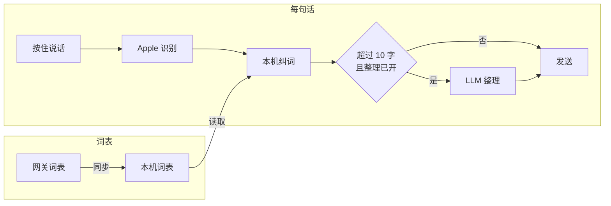

# 语音纠词在本机按词表完成，LLM 只整理长句（设计）

2026-11-24。状态（2026-11-25）：第 2 阶段已上线（rapp-llm 672e022，`GET /v1/vocabulary/rules`）；第 3、4 阶段和第 5 阶段的 D14 第一步已在分支 feat/voice-fix 实现（计划 `docs/superpowers/plans/2026-11-25-rapp-voice-local-fix.md`，提交 aa44c288、0f9dc075、015116e6、56196989、2d9399a1、d3e91d6a），三个阶段并在一条分支里交给 rapp-49；实机验收见 `tasks/todo.md`。第 8 节探针已跑（2026-11-25）：按 D13 换成 `DictationTranscriber` + 热词；D12 的 `setContext` 随之留在新模块上；D14 第二步不做。L2 推迟，用一周后再定。第 12 节 5 件事用户都已定（2026-11-24、2026-11-25）。依据：用户 2026-11-24 的要求；主干代码（提交 02db2d43）；网关代码（rapp-llm 0f3e5c1）；`vocabulary.md` 的现状；现有 5 份语音规格；对开源语音输入法和 Apple Speech、Foundation Models 接口的调研。来源见文末脚注。

修订（2026-11-24，审查后）：补 F7 词表现状；D3 加下限并写明第一天能下发几条；D6 拆成两个字段；D9 改收编规则、区分规则来源；D2、D4、D5、D8、D10、D18 和 7.2 文件表按代码补齐；验收补网关不通的长句、正式词表规则的撤回、编辑路改回原话。

结论：在松手后、发送前加一层本机纠词，用用户确认过的词表做精确替换，耗时按毫秒计。LLM 整理保留，但不再是纠正专有词的唯一环节。Apple 识别先做探针，再决定热词和识别模块怎么用。

标「我定的」的地方都可以改。

## 1. 为什么做

用户 2026-11-24 的要求有 3 点[^owner-request]：

1. 快速纠正语音识别里的个性化词汇：互联网和行业流行词、人名、项目名、黑话。
2. 不用深度思考的 LLM 后处理，因为它慢很多。
3. 充分并且专业地使用 Apple 的识别接口和 Apple 智能接口。

rapp 现在已有完整的语音链路和学习回路[^spec-tidy][^spec-learn]，学习回路的出发点是「把手工纠错写回词表」[^brief]。对照这 3 点，还差 4 件事：

- **专有词只在 LLM 整理里纠正。** 整理的条件是超过 10 个字、接入点已设置、开关已开。10 个字及以下的话原样发出，例如「打开 Hemory」。
- **纠正依赖网络上的模型。** 整理规格 §9 记录过：网关先想几秒，第一个字才出来。整理好之后还要等 1.5 秒才发。
- **热词在新系统上很可能没有生效。** 见第 2 节的 F3。
- **不开 LLM 就学不了新改法。** 「记住」的入口都在整理气泡和 `pendingAi` 上。

## 2. 现在是怎么做的

下面 7 条都对照过主干代码[^rapp-code]，F7 另对照了词表文件和网关代码[^vocab-file][^rapp-llm-code]。

- **F1 识别。** macOS 26、iOS 26 及更新的系统用 `SpeechAnalyzer` 加 `SpeechTranscriber`，报告选项是 `.volatileResults` 和 `.fastResults`。更早的系统用 `SFSpeechRecognizer`。Linux 用本机 Whisper。
- **F2 每次按下都从头准备。** `startAnalyzer` 每次都等 4 件事：查支持的语言、查模型资源、查音频格式、新建分析器。代码里没有调用 `prepareToAnalyze`。
- **F3 热词交给了 `SpeechTranscriber`。** 代码把最多 100 个热词写进 `AnalysisContext.contextualStrings[.general]`，再调 `setContext`。Apple 论坛的答复是：这个偏置只对 `DictationTranscriber` 有效，`SpeechTranscriber` 不支持[^apple-forum-vocab]。有开发者实测：接到 `SpeechTranscriber` 上能编译、能运行，3 句话没有任何效果[^machvoice]。整理规格 §9 的验收第 6 条（热词对比）在 `tasks/todo.md` 里还没有勾。
- **F4 松手。** `VoiceHold._release()` 调 `voice.stop()`，最多等 1 秒拿最终文字。然后二选一：`VoiceTidy.begin` 接走，或者 `sendVoice` 直接发。
- **F5 词表在网关。** `vocabulary.md`（note.md 生成）和 `voice-learned.md`（rapp 里点「记住」写入）都在网关一侧。客户端只拿到 `GET /v1/hotwords` 的热词列表。这个列表只有「正确写法」，没有「听错的写法」。热词只存在内存里，10 分钟过期。
- **F6 学习。** 两个入口：整理气泡里把虚线词点回原话（生成 `preserve`）；编辑路带 `pendingAi` 发出（`editLearns` 生成 `replace`）。两个入口都要先有 AI 结果。
- **F7 词表现状。** `vocabulary.md` 共 31 行，按场景分小节（`## public`、`## team`、`## network` 等），文件头要求「按对话选一个场景，只用它的行」。标 `(always)` 的只有 3 处：「徐逊 → 徐迅」两处，「文萱 → 玟萱」一处。`do not change` 一条也没有。其余条目都是「上下文对得上才改」，例如 `Himory → Hemory`、`老板 → 颖奇`、`老婆 → 静姐`、`Factory → Pacture`。`voice-learned.md` 现在只有标题。网关的 `formalRules` 不分场景，读的时候把 `(always)` 去掉了。`prune`（收编）只要正式词表里有同一个 `observed` 就删掉学到的那条，不看它带不带 `(always)`；学到的 `preserve` 碰上正式词表的替换，也按「以正式词表为准」删掉。

## 3. 目标、不做的、不能出现的

**目标**

- G1 松手后，专有词在 5 毫秒内按下发的规则（D3）改对。任何长度的话都改。网关不通时也改，包括长句整理失败后发出的字。
- G2 按住说话时，气泡里显示的就是改过的字。看到什么，发出去就是什么。
- G3 本机改过的每一处都能撤回。来自学到的规则的改动，还能让它以后不再这样改；来自正式词表的改动，指引用户去 note.md 改（第 12 节第 5 件，已定）。撤回和学习都用现有的虚线词和「记住」。
- G4 不开 LLM 整理时，学习回路照样能用。
- G5 热词要么实测有效，要么从这条路径上拿掉。识别模块按探针数据选。
- G6 按下到第一个字的时间有日志可查。有实测收益时才加预热。

**不做的**

- 不在 Apple 平台内嵌第三方识别模型。
- 不改 Linux 的识别引擎。Linux 只多得到本机纠词，因为那层在 Dart 里。
- 第一版不做拼音近音的自动替换。
- 不改协议，不改 A 端和 relay。
- 不改 LLM 整理的阈值、开关、气泡交互和用途切换。
- 不加新的设置开关。

**不能出现的**

- 普通词被悄悄换成专有词。例如把「九个人」改成「九格人」。
- 纠词让发送变慢，或者让一条本来会自动发出的话卡住。
- 没有用户确认过的改法在本机自动生效。
- 对着密码框说的话被改动、被记录或被学习。
- 本机纠词和 LLM 整理用两套互相矛盾的规则。

## 4. 做法

考虑过 4 种，选第 1 种。

1. **本机规则层，加 Apple 识别修正，加可选的端侧裁决**（选这个）。纠词是 Dart 里的纯函数，规则从网关同步到本机文件。它满足「快」和「不依赖网络」，三端行为一致。代价是要给网关加 1 个只读接口。
2. **把纠词做成网关的非 LLM 接口。** 只有一处实现。但每句话多一次网络往返，网关不通就失效，和 G1 相反。
3. **换成 `DictationTranscriber` 加自定义语言模型，让 Apple 直接写对。** 不用写后处理。但它只对 Apple 平台有效，会放弃新模型，而且公开的实测结果不一致[^listentome][^enviouswispr]。它作为第 1 种里的探针项保留。
4. **继续全靠 LLM，把 10 个字的阈值降到 0。** 改动最小，但每句话都要等模型。用户已排除。

开源语音输入法的共同做法也是第 1 种的形状：识别给「建议」，识别后的规则层做「强制」，两份词表分开[^asr-hotword]。

## 5. 设计总览

图 1 的结论：两条发送路径都先经过本机纠词，纠词时不访问网络。



先看「每句话」一组：本机纠词在识别之后、分支之前，所以长句和短句都经过它。再看「词表」一组：本机词表是网关词表的副本，箭头只在同步时经过网络。

各层的职责和时间预算如下。预算是目标值，探针和日志用来核对。

| 层 | 在哪里 | 做什么 | 预算 |
|---|---|---|---|
| L0 识别 | Swift，`SpeechPlugin` | 出字，尽快出第一个字 | 第一个字 500 毫秒内 |
| L1 本机纠词 | Dart，新文件 `voice_fix.dart` | 按词表精确替换 | 5 毫秒内 |
| L2 端侧裁决 | Swift，Foundation Models，可选 | 近音候选里几选一 | 300 毫秒，超时放弃 |
| L3 LLM 整理 | 现有 `VoiceTidy` | 理顺长句 | 不变 |

## 6. 决定和意图

每个决定写 3 行：做法、意图、没选的。除特别注明外，都是我定的。

### 6.1 本机纠词（L1）

**D1 纠词写在 Dart，三端共用一份。**

- 做法：新建 `gui/lib/embed/voice_fix.dart`，一个纯函数 `fixVoice(text, rules)`，返回改后的文字和改动列表。
- 意图：`VoiceHold` 和 `VoiceTidy` 本来就在 Dart 里，iOS、macOS、Linux 共用。纯函数可以像 `tidy_diff.dart` 一样用表驱动测试。
- 没选：在 Swift 里做。那样 Linux 没有，规则要维护两份。

**D2 第一版只做精确匹配。**

- 做法：先找出所有 `preserve` 的出现位置并占住；再从左到右，取最长的替换，替换不能和占住的范围重叠。拉丁字母不分大小写，并且要求词边界。中日韩文字按字符匹配。
- 意图：结果可以预测。误伤的上限就是规则本身。模糊匹配的误伤有现成的教训：Handy 把「and roast」整段换成了「Anthropic」[^handy-fp]。
- 没选：拼音模糊匹配。两个字的名字很容易和普通词同音，见 D15。

**D3 规则只来自用户确认过的条目。**

- 做法：下发 3 类。
  1. `vocabulary.md` 里带 `(always)` 的替换，不论写在哪个场景小节下。同一个 `observed` 在不同小节里指向不同写法时，这一条不下发。
  2. `vocabulary.md` 的 `do not change`。
  3. `voice-learned.md` 的全部条目。

  不带 `(always)` 的替换不下发（第 12 节第 4 件，用户已定：不放宽，常错的词由用户在 note.md 里补 `(always)`，候选见第 13 节）。`observed` 去掉空白后少于 2 个字的不下发，只留给 LLM。网关过滤一次，客户端 `compile` 时再挡一次。
- 意图：L1 没有判断能力，所以只执行不需要判断的规则。需要看上下文的规则留给 LLM。这也守住「没确认的改法不自动生效」。`(always)` 的意思就是「每次都改」，所以不看它在哪个场景下。下限的理由：编辑路能学出「在 → 再」这种单字规则（`editLearns` 只有 12 个字的上限，没有下限）。交给 LLM 时它会看上下文，交给 L1 就是处处都换。
- 代价要说清：按 F7，第一天能下发的只有 2 条（「徐逊 → 徐迅」「文萱 → 玟萱」）。第 1 节的「打开 Hemory」靠的是 `Himory → Hemory`，它不带 `(always)`，L1 不改。L1 的收益要靠学习回路一条条攒，或者用户在 note.md 里给常错的词补 `(always)`。
- 没选：把热词列表也当规则。热词只有正确写法，没有「听错成什么」，无从替换。把不带 `(always)` 的也下发：`老板 → 颖奇`、`老婆 → 静姐` 会直接触发「不能出现的」第 1 条。

**D4 规则存成本机文件，从网关同步。**

- 做法：网关新增 `GET /v1/vocabulary/rules`（见 7.4）。客户端把结果写进 `local/voice-rules.json`，权限 0600，写法同 `llm.json`，文件里记下拉取时间和接入点地址。同步时机跟热词一样：启动、换接入点、「记住」或删除之后，以及录音时发现副本超过 10 分钟（和 `_refreshHotwords` 一样在用到时才拉，不定时拉）。副本的接入点和当前的不同时，不用这份副本，当空表，直到新接入点拉到结果。
- 意图：纠词时不访问网络，启动后马上可用，网关不通时用上一次的副本。文件里有人名，所以放 `local/`，不进同步目录。记下接入点，是为了换到一个不通的新网关时，不沿用另一个网关的规则。
- 没选：只放内存。那样每次启动后、网关不通时都是空表。

**D5 改动同时作用在按住时的字和松手后的字上。**

- 做法：`VoiceHold` 提供 `fixedText`（`fix(voice.text)` 的结果），两个气泡都改读它：`voice_overlay.dart:279`（iOS）和 `voice_desktop.dart:405`（桌面）。`_release()` 里对最终文字再算一次，下面这些地方一律用改后的字：`wouldTidy`、`prefetch`、`tidy`、`send`、`edit`，以及会话切走时的 `draft.keep`。`fix` 回调在两处创建 `VoiceHold` 的地方都要接：`composer_panel.dart:992` 和 `voice_desktop.dart:88`。`VoiceInput.text` 本身保持原样，现有测试不动。
- 为什么 `wouldTidy` 也要用改后的字：「拍森 → Python」会让字数跨过 10 个字的阈值。`wouldTidy` 用原话、`tidy` 用改后的字，两边答案不同，交接时气泡会闪一下。
- 意图：所见即所发（G2）。短句没有整理气泡，按住时看到的字是唯一的检查机会。
- 没选：只在松手后改。那样短句发出去的字和气泡里看到的不一样。

**D6 原话一律指识别器的原样输出。**

- 做法：`VoiceTidy.begin(text, pick, {at, heard})`，内部拆成两个字段。
  - `_heard`（`heard ?? text`）：只用于对照和学习。具体是 `tidyChanges(_heard, 结果)`、`VoiceAi.original`、气泡里的「原话」行、`learnExcerpt` 的 excerpt。
  - `_original`（改后的 `text`）：其余所有路径照旧用它。具体是 LLM 输入、预取比对 `_takeAhead`、失败或超时的 `_goOriginal`、整理中点「直接发送」的 `sendNow`、「还原」、没出结果时点「编辑」的 `editNow`、`closed` 和 `end` 留进草稿、退出时的 `held`。
  - 「还原」退回 L1 的结果，不退回识别器原样。单处撤回 L1 用虚线词。
- 意图：`tidyChanges(原话, 结果)` 会把 L1 的改动也标成虚线词。用户点一下就能切回原话，并得到「记住：别把 X 改成 Y？」（G3）。学习规格要求 `observed` 必须是识别器听到的片段，这样做不破坏它。发送路径不用 `_heard`，否则网关不通时长句整理失败，发出去的就是没改过的原话（G1）；预取的键是改后的字，比对时也得用改后的字，否则预取永远命中不了。`allowed` 只看开关和接入点是否设置，不看网关通不通，所以网关不通时长句也会先进整理再失败。
- 没选：把改后的文字当原话。那样 L1 的改动在气泡里看不出来，也撤不回。只改一个 `_original = heard`：上面列的发送路径会全部丢掉 L1 的改动。

**D7 密码框不纠词。**

- 做法：`rs.secureFocus` 为真时跳过 L1，也不出任何「记住」提示。
- 意图：密码要原样。这和整理规格里「对着密码框说的话不送去整理」是同一条线。

### 6.2 学习回路

**D8 编辑路在没有 AI 时也能学。**

- 做法：短句或关掉整理时，选「编辑」把改后的文字放进写作面板，composer 记下 `pendingHeard`（原话和 L1 结果）。每次不经 AI 的「编辑」都记，不管 L1 改没改；没改时原话和 L1 结果相同。发出时调 `editLearns(原话, L1 结果, 发出的字)`，提示和勾选框不变。清掉 `pendingHeard` 的规则同 `pendingAi`。网关被拦、留进草稿的 `sendVoice` 那条路（`voice_button.dart:76`）也带上 `pendingHeard`。
- 改回原话：如果发出的字把 L1 的某处改动改回了原话，这一处生成 `preserve`，不生成 `replace`。`editLearns` 现在遇到 `observed == output` 会直接跳过（`tidy_diff.dart:246`），要改：这一段在「原话 ↔ L1 结果」上是一处改动、发出的字又等于原话那一侧时，产出 `LearnItem.preserve(observed: 原话片段, avoid: L1 片段)`。来自正式词表的改动不生成，见 D9。
- 意图：现在两个学习入口都要先有 AI 结果。用户要的是不靠 LLM 也能越用越准（G4）。`editLearns` 本来就是三方比对，把 AI 结果换成 L1 结果就能复用。
- 没选：给短句发送后弹「改得对吗」。字已经打进对方的 app，撤不回，提示只会打扰。

**D9 冲突由网关一处解决，客户端只执行。**

- 做法：`rules` 接口返回已经解决冲突的列表，每条带来源 `source`：`vocabulary` 或 `learned`。冲突规则沿用学习规格：同一个 `observed` 新规则盖旧规则；和正式词表冲突时以正式词表为准。收编改一处：学到的 `replace` 只有在正式词表里同一条带 `(always)` 时才删。正式词表里那条不带 `(always)` 时，学到的那条留在 `voice-learned.md`。改法见 7.4。
- 来源决定撤回怎么走：
  - `learned` 的替换：点回原话生成 `preserve`，同一个 `observed` 新盖旧，下一次同步后 L1 那条失效。
  - `vocabulary` 的替换：网关会按「以正式词表为准」删掉这条 `preserve`，发了也没用。所以点回原话只撤这一次，提示改成「这条在正式词表里，要改请去 note.md」，不发 `learn`（第 12 节第 5 件，用户已定）。
- 意图：L1 和 LLM 整理读的是同一份结论，不会出现两边规则不一致。收编改法的理由：学到的 `拍森 → Python` 交给 note.md 确认后，如果落进正式词表时没带 `(always)`，原来的收编会删掉学到的那条，D3 又不下发不带 `(always)` 的，L1 就从「会改」变成「不改」。来源要下发，是因为不分来源时，用户点「记住」会显示成功，但下一句照改。

**D10 「记住」之后马上同步规则。**

- 做法：`_learnItems` 和 `forgetLearned` 成功后都会调 `_forgetHotwords`（`main_state.dart:3378–3405`），`rules` 的失效和重拉挂在同一处。`learn` 成功时，先把这条写进本机规则（盖掉同一个 `observed` 的旧条，`source` 记为 `learned`），再拉 `rules` 校正。`forget` 只重拉，不在本机删，因为本机副本里没有条目 id。
- 意图：验收时能做到「改一次，下一句就对」，不用等 10 分钟，也不用等网关来回一趟。

### 6.3 Apple 识别（L0）

**D11 先做探针，再改识别代码。**

- 做法：用 30 段另外录的录音，离线跑 4 组对照（见第 8 节）。结果写回本文。
- 意图：热词是否生效、换模块是否值得，Apple 没有完整文档，公开实测互相矛盾[^listentome][^enviouswispr]。学习规格 §6.1 也是先探针再写代码，这里照同样的做法。

**D12 热词按探针结果处理，不保留无效的调用。**

- 做法：如果探针确认 `SpeechTranscriber` 不理会 `contextualStrings`，就在这条路径上删掉 `setContext`。`SFSpeechRecognizer` 路径（旧系统）的 `contextualStrings` 保留。
- 意图：不生效的代码会让人以为热词已经在帮忙，排查错词时走弯路。

**D13 识别模块只留一条路，由探针决定，不做成设置。**

- 做法：默认继续用 `SpeechTranscriber`。只有当 `DictationTranscriber` 同时满足 3 个条件才换：30 段里专有词多对 5 段及以上；整体错字率不高于 `SpeechTranscriber` 的 1.1 倍；第一个字不慢 100 毫秒以上。换的写法见 7.3。
- 意图：macOS 规格定过「保持极简，跟随系统」[^spec-voice]，所以不给用户加「识别引擎」开关。有了 L1 之后，专有词已经有强制纠正，换模块的收益要足够大才值得放弃新模型。
- 没选：两个模块同时跑再合并。耗电和复杂度翻倍。

**D14 预热分两步，第二步看数据。**

- 做法：第一步，把语言、资源、音频格式的查询结果按语言缓存，按下时不再等。同时加一行计时日志：按下到第一个字、松手到最终文字、L1 耗时、松手到发出。第二步，只有探针显示第一个字能快 150 毫秒及以上时，才提前建好一套「备用分析器」并调 `prepareToAnalyze(in:)`[^apple-analyzer]。
- 意图：第一步没有风险。第二步要在空闲时占内存，值不值得要看数据。麦克风始终只在按住时打开，预热不碰音频。
- 没选：按下时才调 `prepareToAnalyze`。音频紧跟着就到，预热来不及起作用。

### 6.4 端侧裁决（L2，可选）

**D15 近音候选只标不改，除非裁决通过。**

- 做法：一段字的拼音（不看声调）和词表里某个词相同、字不同、又没有精确规则时，它是「近音候选」。候选不自动替换。
- 意图：两个字的名字常和普通词同音。自动替换会直接触发「不能出现的」第 1 条。候选一旦被用户确认，就按现有回路变成精确规则，以后由 L1 处理。

**D16 Apple 智能只做几选一，不重写句子。**

- 做法：用 Foundation Models 的端侧模型，从「原文」和候选里选 1 个。输出用 `anyOf` 约束锁在候选集内[^apple-fm-guide]。采样用 `.greedy`，输出上限 16 个 token。每次裁决用新的会话，按下时预热。裁决和 `voice.stop()` 的等待并行，300 毫秒没有结果就用原文。具体调用见 7.5。
- 意图：这是端侧模型最合适的位置：看上下文消歧，输出只有几个 token，模型没有机会改别的字。并行加超时保证它不拖慢发送。预热只对调用它的那个会话有保证[^apple-prewarm]，所以要「预热一个，用完换一个」。
- 没选：让端侧模型整句纠错。延迟和过度纠正都来自重写整句。

**D17 裁决的结果不自动变成规则，L2 是否上线看探针。**

- 做法：裁决选中的候选在气泡里是虚线词。只有用户点「记住」才写入词表。上线条件：30 句里选对 27 句及以上，并且 95% 的请求在 300 毫秒内返回。
- 意图：守住「没确认的改法不自动生效」。端侧模型对中文人名的消歧能力没有公开数据，所以用探针定。Linux 没有这一层，行为退回「只标不改」。

### 6.5 网关和记录

**D18 网关只加 1 个只读接口，先上网关再上客户端。**

- 做法：`GET /v1/vocabulary/rules`，带 `etag`。只有 200 才写本机文件；304 只更新拉取时间；404 和其他失败都不动本机副本，继续用副本，没有副本就是空表。旧网关返回 404，没有副本，所以行为和现在一样。
- 意图：新旧版本可以任意组合，不会出现整理规格里担心过的「所有设备悄悄按原话走」。

**D19 输入记录加一个可选字段。**

- 做法：L1 改过、又没有 AI 时，记录多一个 `"fix": {"heard": "<原话>"}`，`source` 仍是 `voice`。有 AI 时不加，因为 `ai.original` 已经是原话。
- 意图：以后查「这句为什么被改成这样」有据可查。读记录的代码照旧跳过不认识的字段。

**D20 日志只记数量和耗时，不记文字。**

- 做法：每次纠词一行：命中几条规则、耗时多少毫秒。裁决一行：候选数、耗时、是否超时。
- 意图：和整理、网关现有的日志规矩一致。

## 7. 接口和文件

本节写到「实现的人不用再回头问」的程度。Swift 片段按 Apple 文档和示例写，签名以本机 SDK 为准。

### 7.1 `voice_fix.dart`（新）

```dart
enum FixAction { replace, preserve }

/// 规则从哪来（D9）：决定点回原话时能不能学。
enum FixSource { vocabulary, learned }

class FixRule {
  const FixRule.replace(this.observed, String this.output, this.source) : action = FixAction.replace;
  const FixRule.preserve(this.observed, this.source) : action = FixAction.preserve, output = null;
  final FixAction action;
  final String observed;
  final String? output;
  final FixSource source;
}

/// 位置是改后文字里的 rune 偏移，和 TidyChange 一致。
class FixChange {
  const FixChange(this.start, this.end, this.before, this.after, this.source);
  final int start, end;
  final String before, after;
  final FixSource source;
}

class FixResult {
  const FixResult(this.text, this.changes);
  final String text;
  final List<FixChange> changes;
}

/// 规则同步后编译一次；fix 是纯函数。
class VoiceRules {
  factory VoiceRules.compile(List<FixRule> rules) => throw UnimplementedError();
  static final VoiceRules empty = VoiceRules.compile(const []);
  FixResult fix(String text) => throw UnimplementedError();
}
```

匹配规则（D2）：

1. 第一遍只看 `preserve`：从左到右、取最长，找出所有出现位置并占住，这些范围原样保留。
2. 第二遍只看 `replace`：位置从左到右。同一位置有多条规则能匹配时，取 `observed` 最长的一条。和第一遍占住的范围有重叠的匹配不算。
3. 匹配过的范围不再参与后面的匹配。
4. `observed` 全是拉丁字母、数字或空格时：不分大小写；两端应是词边界（前后不是拉丁字母或数字）。中日韩字符算边界，所以「用cloud跑」里的 `cloud` 能匹配。
5. 其他情况按 Unicode 字符逐个比较。
6. `output` 原样写入，不跟着原文改大小写。
7. `compile` 丢掉 `observed` 去掉空白后少于 2 个字的规则（D3），网关已经过滤过，这里再挡一次。

表驱动测试至少覆盖：最长匹配、重叠、词边界（`cloud` 不匹配 `cloudflare`）、大小写、`preserve` 挡住更短的替换、替换起点在 `preserve` 前面又和它重叠（替换不生效）、单字规则被丢掉、空表、中英混排。再加 1 条性能测试：1000 条规则、500 字，不超过 5 毫秒。

### 7.2 现有文件的改动

| 文件 | 改动 | 对应决定 |
|---|---|---|
| `gui/lib/llm_api.dart` | 新增 `rules(endpoint, {etag})`，返回 200 的内容、304、或失败（null），不抛异常 | D4、D18 |
| `gui/lib/ui/main_state.dart` | 启动时读 `local/voice-rules.json`，接入点不同就不用；`_refreshRules()` 和 `_refreshHotwords()` 同时机；`_forgetHotwords` 里一起失效；`_learnItems` 成功的条目先写进本机规则；提供 `voiceFix(sid, text)`，密码框时原样返回；`onAiSent` 旁边加 `onHeardSent`，调 `editLearns` 并按 D9 去掉来自正式词表的 `preserve` | D4、D7、D8、D10 |
| `gui/lib/embed/voice_button.dart` | `VoiceHold` 新回调 `fix` 和 `fixedText`；`_release()` 把改后的字和 `heard` 一起交给 `wouldTidy`、`prefetch`、`tidy`、`send`、`edit`、`draft.keep`；`sendVoice` 留进草稿时带上 `pendingHeard` | D5、D6、D8 |
| `gui/lib/embed/voice_overlay.dart` | 气泡读 `hold.fixedText`，不读 `voice.text`（:279） | D5 |
| `gui/lib/embed/voice_desktop.dart` | 气泡读 `hold.fixedText`（:405）；创建 `VoiceHold` 时接 `fix`（:88） | D5 |
| `gui/lib/embed/composer_panel.dart` | 创建 `VoiceHold` 时接 `fix`（:992）；`edit` 回调记下 `pendingHeard` | D5、D8 |
| `gui/lib/embed/voice_tidy.dart` | `begin(text, pick, {at, heard})`；拆成 `_heard` 和 `_original` 两个字段，用法按 D6 的清单；点回来自正式词表的虚线词时不出「记住」，改出指向 note.md 的提示 | D6、D9 |
| `gui/lib/embed/tidy_diff.dart` | `editLearns` 对「改回原话」产出 `preserve`，不再跳过 | D8 |
| `gui/lib/embed/composer_model.dart` | `VoiceOrigin({ai, heard})`；`pendingHeard`（原话、L1 结果、改动列表），清除规则同 `pendingAi`，`adoptFrom` 一起带走；`submit` 带 `pendingHeard` 发出时调 `onHeardSent` | D8、D19 |
| `gui/lib/history/input_recorder.dart` | `_sentRecord` 在 `voice.heard` 有值、没有 `ai`、且和发出的字不同时写 `fix.heard` | D19 |
| `gui/macos/Runner/SpeechPlugin.swift` | 见 7.3（iOS 工程直接引用这个文件） | D12–D14 |

`voice-rules.json` 的内容就是 7.4 的响应体，外加拉取时间和接入点地址。文件读不出来或格式不对时当空表。

### 7.3 `SpeechPlugin.swift`

**第一步（不依赖探针）：缓存和计时。**

- 按语言缓存 `supportedLocale(equivalentTo:)`、资源是否已装、`bestAvailableAudioFormat(compatibleWith:)` 的结果。资源查询失败或系统语言变了就清缓存。
- 向 Dart 发 1 个新事件 `timing {first_partial_ms, final_ms}`：按下到第一个 `partial`，`stop` 到 `final`。Dart 补上 L1 耗时和松手到发出的时间，写 1 行日志。

**第二步（探针 P3 通过才做）：备用分析器。**

- 新方法 `warm`：Dart 在「能说话」变为真时调用（时机同 `set_voice_ready`）。原生建好 transcriber 和 analyzer，调 `prepareToAnalyze(in: format)`，留着给下一次 `start` 用。
- 每次录音结束后，在后台再建一套。
- iOS 进后台、macOS 主窗口失去 key 时丢掉备用的那套。
- 麦克风和 `AVAudioEngine` 不提前启动。

**如果探针 P2 决定换模块（D13）**，写法照 Apple 的 iOS 27 示例[^apple-live-audio]：

```swift
let preset = DictationTranscriber.Preset.progressiveLongDictation
let hints = lmConfig.map { preset.contentHints.union([.customizedLanguage(modelConfiguration: $0)]) }
    ?? preset.contentHints
let transcriber = DictationTranscriber(
    locale: locale,
    contentHints: hints,
    transcriptionOptions: preset.transcriptionOptions,
    reportingOptions: preset.reportingOptions,
    attributeOptions: preset.attributeOptions)

let context = AnalysisContext()
context.contextualStrings[.general] = Array(hotwords.prefix(100))
try await analyzer.setContext(context)
```

- 热词上限 100 条，录音中也可以用 `setContext` 更新。
- 自定义语言模型用 `SFCustomLanguageModelData` 生成：每个词表词配 3 到 5 个例句（`PhraseCount`），生词可以加读音（`CustomPronunciation`，X-SAMPA 记号）。再调 `SFSpeechLanguageModel.prepareCustomLanguageModel(for:configuration:)`。`rules` 的 `etag` 变了就在后台重建。
- 先用 `SFCustomLanguageModelData.supportedPhonemes(locale:)` 查中文支持哪些读音记号。不支持就只用例句，不加读音。

### 7.4 网关接口（新）

```
GET /v1/vocabulary/rules
Authorization: Bearer <key>
If-None-Match: "<etag>"        （可选）

200
{"etag": "9f2c…",
 "rules": [
   {"action": "replace",  "observed": "徐逊",   "output": "徐迅",   "source": "vocabulary"},
   {"action": "replace",  "observed": "拍森",   "output": "Python", "source": "learned"},
   {"action": "preserve", "observed": "黑猫瑞",                     "source": "learned"}
 ]}

304   （etag 没变，没有响应体）
```

- 来源和顺序（D3、D9）：`vocabulary.md` 的 `(always)` 替换和 `do not change`，再加 `voice-learned.md` 的全部条目。冲突按学习规格 §6.3 解决后再返回，收编按下面改过的规则。`observed` 少于 2 个字的不返回。
- `etag` 是规则列表的摘要。两份文件任何一份变了，`etag` 就变。
- 照旧要 key。日志 1 行，不记词。

网关一侧要改的地方（对照 rapp-llm 0f3e5c1 的 `learned.mjs`[^rapp-llm-code]）：

- `formalRules` 现在读替换时把 `(always)` 去掉，也不分场景小节。要多返回一个「带 `(always)` 的替换」集合，同一个 `observed` 在不同小节里指向不同写法时不放进去。`rules` 接口只用这个集合和 `preserve` 集合。
- `prune` 的 `same` 分支：学到的 `replace` 只有在正式词表里同一条带 `(always)` 时才算 `same` 被删。正式词表里那条不带 `(always)` 时保留。`conflict` 分支照旧，这是学习规格 §6.3 的改动，要同步改那份规格。
- 本文只看了 `learned.mjs` 和 `rapp-llm.mjs` 的路由，网关的工作量是估计。

### 7.5 端侧裁决（L2）

通道 `rapp/speech` 新方法 `pick`。参数是 `{text, terms}`，返回 `{picks: [{start, end, output}]}`，位置是 rune 偏移。系统不支持或模型不可用时返回空列表。

原生一侧的步骤：

1. 用 `CFStringTransform` 把文字和词表词转成不带声调的拼音，找出拼音相同、字不同的片段。最多取 3 处。
2. 对每一处，从「原文」和候选里选 1 个：

```swift
guard case .available = SystemLanguageModel.default.availability else { return [] }

let schema = try GenerationSchema(
    root: DynamicGenerationSchema(name: "pick", anyOf: [original] + candidates),
    dependencies: [])
let response = try await session.respond(
    to: "句子：\(sentence)\n片段：\(original)",
    schema: schema,
    options: GenerationOptions(sampling: .greedy, maximumResponseTokens: 16))
```

3. 会话的 `instructions` 固定为一句话：只在上下文明确指向某个候选时才选它，否则选原文。
4. `start`（按下）时，如果词表不空，就建一个会话并调 `prewarm(promptPrefix:)`。用过的会话丢掉，再建下一个。
5. iOS 27、macOS 27 上，`respond` 可以加 `contextOptions: ContextOptions(reasoningLevel: .light)`[^wwdc26-241]。

Dart 一侧：`_release()` 里和 `voice.stop()` 同时发 `pick`，用按住时最后看到的字。最终文字到了以后，只采用片段仍然存在的结果。总等待不超过 300 毫秒。

## 8. 探针

探针用 30 段另外录的录音，不从产品里存音频。朗读清单从 `voice-learned.md` 和 `hotwords.md` 里挑最常错的词，每句 1 到 2 个词，中英混说占一半。

| 编号 | 比什么 | 怎么比 | 决定什么 |
|---|---|---|---|
| P1 | `SpeechTranscriber` 带热词和不带热词 | 同样 30 段，数专有词写对的段数 | 两组相差不到 2 段：D12 删掉 `setContext` |
| P2 | `DictationTranscriber` 加热词、再加自定义语言模型 | 专有词段数、整体错字率、第一个字的时间 | 是否满足 D13 的 3 个条件 |
| P3 | 有没有 `prepareToAnalyze` | 第一个 `partial` 的时间，各跑 10 次取中位数 | 快 150 毫秒及以上：做 D14 第二步 |
| P4 | 端侧模型几选一 | 30 个近音句子，看选对几句和耗时 | 是否满足 D17 的上线条件 |

P1 到 P3 用 `analyzer.analyzeSequence(from: 音频文件)` 离线跑，结果可以重复，录音和朗读清单见第 14 节。P4 在本机用 Foundation Models 跑，和 L2 一起推迟（第 12 节第 3 件），这次不做。P1 到 P3 的结果写回本节。

**结果（2026-11-25）**

用户录了 30 段（第 14 节清单）。在本机 macOS 27.0.1 上离线跑，语言 zh-CN，热词用网关当时的 99 个（清单里的专有词全在里面）。探针程序和逐句结果在 `~/voice-probe/probe/`，不进仓库。「全对」指这一段里加粗的词全部写对；错字率按字算，去掉空格和标点，不分大小写。

| 配置 | 专有词全对 | 错字率 |
|---|---|---|
| `SpeechTranscriber`（现在的配置） | 4/30 | 16.5% |
| `SpeechTranscriber` + 热词 | 4/30，30 段输出逐字相同 | 16.5% |
| `DictationTranscriber`（`progressiveLongDictation`） | 6/30 | 44.4%，第 1 段首次运行报 RecogFailed，算全错 |
| `DictationTranscriber` + 热词 | 17/30 | 14.6% |
| `DictationTranscriber` + 热词 + 自定义语言模型 | 17/30 | 13.5%，模型构建 0.45 到 0.54 秒 |

第一个字的时间：10 段，按真实时长逐块送音频，从「按下」量到第一段非空的临时结果。数字里含每段开头的静音，所以只看同一段内的差。

| 配置 | 中位数 |
|---|---|
| `SpeechTranscriber` + 热词，不预热 | 1967 毫秒 |
| `SpeechTranscriber` + 热词，提前 `prepareToAnalyze` | 1984 毫秒，逐段差 −26 到 +18 毫秒 |
| `DictationTranscriber` + 热词 | 1593 毫秒，逐段差的中位数约 −8 毫秒（−708 到 +756） |

结论：

- **P1：**`SpeechTranscriber` 不理会热词。按 D12，这条路径不再调 `setContext`；因为换了模块（下一条），`setContext` 改由 `DictationTranscriber` 用，它是生效的。
- **P2：**`DictationTranscriber` + 热词满足 D13 的 3 个条件：专有词多对 13 段（要求 5 段）；错字率 14.6%，低于 16.5%；第一个字不慢。所以换模块。自定义语言模型没有多对一段，只降了 1.1 个点的错字率，却要多一次构建和缓存，这次不加。
- **P3：**预热没有快，反而略慢。按 D14，第二步（备用分析器）不做。
- 还没验证的：探针只在 macOS 上跑；iPad、Duo 上的效果靠实机检查。第 1 段 `DictationTranscriber` 首次运行报过一次 RecogFailed，第二次就好了；真机上如果第一次按住报错，会走现有的失败提示。

## 9. 阶段

1. **探针**（第 8 节）。半天。
2. **网关**：`rules` 接口，加上 7.4 的 `formalRules`、`prune` 改动，同步改学习规格 §6.3。在 rapp-llm 的 worktree 里改，不在主目录切分支。
3. **L1**：`voice_fix.dart`、规则同步、D5 到 D7、D9 的来源区分、D19、D20。可以和 2 并行，接口没上线时用空表和假数据测。
4. **学习**：D8、D10。依赖 2 和 3。
5. **L0**：D14 第一步直接做；D12、D13、D14 第二步按探针结果做。
6. **L2**：D15 到 D17。推迟：第 3、4 阶段上线后用一周，看还剩多少近音错词，再由用户定做不做；做的话先跑 P4，通过才上线。这次的计划不含这一阶段。

每个阶段单独分支，交给 rapp-49 合并。第 3、4 阶段完成后，「快、不靠 LLM」的路已经通了，后面的阶段都是增量。但按 F7，刚上线时下发的规则只有 2 条，L1 能改对多少词，取决于用户在 note.md 里补了多少 `(always)`（第 13 节），以及学习回路攒了多少条。

## 10. 验收（实机）

**本机纠词和学习**

下面各条里的「拍森 → Python」是 `voice-learned.md` 里学到的规则（可以先在 rapp 里学一次）；第 5 条用的是正式词表里带 `(always)` 的「徐逊 → 徐迅」。

1. 说「打开拍森」（10 个字以内）：按住时气泡里就是 Python，松手后 A 收到 Python。
2. 停掉网关，重启 rapp，再说第 1 条：结果一样。
3. 网关停着、整理开着，说一段超过 10 个字、含「拍森」的话：整理失败后，A 收到的是 Python。
4. 网关正常，说一段超过 10 个字、含「拍森」的话：整理气泡里 Python 下有虚线，「原话」行里是「拍森」。点 Python 切回「拍森」，出现「记住：别把『拍森』改成『Python』？」。点「记住」后，下一句不再改。另说一句，在整理好的气泡上点「还原」：A 收到的是 Python，不是「拍森」。
5. 来自正式词表的规则：说一段含「徐逊」的长句，点虚线的「徐迅」切回：这一次发「徐逊」，提示指向 note.md，没有「记住」；下一句照样改成「徐迅」。
6. 关掉「长语音先让 AI 整理」。说一句识别错的新词，选「编辑」，在写作面板里改对并发出：出现「记住这个改法？」。点「记住」后，下一句（任何长度）直接改对，网关慢的时候也是。
7. 关掉整理，说「打开拍森」，选「编辑」，在写作面板里把 Python 改回「拍森」发出：出现「记住：别把『拍森』改成『Python』？」，点「记住」后下一句不再改。
8. 密码框会话：说词表里的词，A 收到的是识别器的原样，没有任何提示。
9. 输入历史：第 1 条的记录里有 `fix.heard`，第 4 条的记录里 `ai.original` 是识别器原样。
10. 说「九个人」之类和某个词表词同音的普通话：没有被改。
11. 编辑路学一条单字改法：`rules` 的返回里没有它，本机纠词不改；LLM 整理仍照它改。
12. 把一条学到的规则在 note.md 里确认成不带 `(always)` 的正式条目：`rules` 里仍有它，L1 照改。

**识别和时间**

13. 日志里每次语音有 1 行计时：按下到第一个字、松手到最终文字、L1 耗时、松手到发出。L1 耗时不超过 5 毫秒。
14. 探针 4 项的结果已经写回第 8 节，D12、D13、D14、D17 各有结论。
15. 如果做了 L2：说一句上下文明确的近音句，气泡里候选带虚线；关掉 Apple 智能后同一句不改、不报错、不变慢。
16. Linux：第 1 到第 7 条照样通过。

## 11. 留给实现的人

- `VoiceRules.compile` 用哪种结构（按首字符分桶的表，或 Aho-Corasick 自动机）。规则在 1000 条以内时两种都够快。
- 气泡里改后的字要不要有视觉区别。我的建议是不加，保持和现在一样。
- `timing` 事件的字段名和日志格式。
- 网关 `etag` 的算法、`rules` 的内部缓存。
- 备用分析器的丢弃时机细节。
- L2 的 `instructions` 措辞，用 P4 的 30 句调。

## 12. 需要用户定的，和不确定之处

**需要用户定的**

1. **短句改过就直接发。** 用户 2026-11-25 已定：直接发，不加停顿。10 个字以内的话没有整理气泡。L1 改过之后只能靠按住时看字，或者滑到「编辑」拦下。规则都是用户确认过的；万一改错，在下一次整理气泡里点回原话，或去 note.md 改。
2. **探针录音。** 用户 2026-11-25 已定：录。用户另录 30 段（约 10 分钟），朗读清单和录法见第 14 节。
3. **L2 做不做。** 用户 2026-11-25 已定：先不做。第 3、4 阶段上线后用一周，看还剩多少近音错词，再定。它只在 Apple 平台有，要多一条通道方法，Swift 代码估计 150 行左右。
4. **不带 `(always)` 的正式词表条目怎么办。** 用户 2026-11-24 已定：选 A，候选清单见第 13 节。按 F7，正式词表绝大多数条目不带 `(always)`，L1 第一天只有 2 条规则，`Himory → Hemory` 也不在里面。可选的做法：
   - A（我建议）：L1 只用 `(always)`。用户在 note.md 里给常错、又不会误伤的词补 `(always)`，例如 `Himory、Himmary、Himmery → Hemory`。我可以先从词表和热词里列一份候选清单给用户勾。
   - B：不带 `(always)` 的条目在 L1 里只标不改（D15 的做法），气泡里标出来，靠用户点。这要等 L2 或者另做标注界面。
   - C：放宽成「`observed` 全是拉丁字母的也下发」。`Himory` 这类可以，但 `Factory → Pacture`、`self-hosted → 自托管服务端` 会误伤，要再加例外。
5. **撤回来自正式词表的改动。** 用户 2026-11-24 已定：选 A。学习规格定了「和正式词表冲突时以正式词表为准」，所以在 rapp 里点「记住：别改」对正式词表的规则无效。可选的做法：
   - A（我建议）：点回原话只撤这一次，提示「这条在正式词表里，要改请去 note.md」，不出「记住」。正式词表仍是唯一的权威。
   - B：rapp 学到的 `preserve` 可以盖过正式词表。要改学习规格 §6.3，LLM 整理那边也要跟着改，否则两边规则不一致。

**不确定之处**

- `SpeechTranscriber` 不理会热词，依据是 Apple 论坛的答复和第三方实测，没有在用户的机器上验证。P1 就是为了验证它。
- `DictationTranscriber` 有没有 `.fastResults`，中文支持哪些自定义读音，没有查到。
- `reasoningLevel` 的完整取值、`DynamicGenerationSchema` 的准确签名，要对照 SDK。
- 端侧模型对中文人名的消歧能力没有公开数据。
- 备用分析器空闲时占多少内存，没有数据。
- 网关只读了 `learned.mjs` 和路由，`rules` 接口和收编改动的工作量是估计。
- note.md 确认 rapp 提交的候选时，写进正式词表的条目带不带 `(always)`，没有查到。D9 的收编改法就是为了不依赖这一点。

## 13. 补 `(always)` 的候选清单（给用户在 note.md 里勾）

按第 12 节第 4 件 A。`vocabulary.md` 是只读的，改动由用户在 note.md 里做，或用 `notemd conversation-dictionary propose` 提。

挑选标准：左边是听错的写法（同音字、拼写变体、拼音），而且不是日常会说的普通词；L1 会处处替换它，所以拿不准的不放进来。别名、简称、昵称（例如 `老板 → 颖奇`、`王春生 → 春生`、`Bruce → 峻哥`）是说法不同，不是听错，一律不列。

注意写法：`(always)` 作用于整个 `x, y → A` 条目，左边每个写法都会被替换。所以要把能放心替换的写法单独拆成一条，再加 `(always)`。另外 `(always)` 对 LLM 整理也生效，从「上下文对得上才改」变成「每次都改」。

**建议勾**

| 场景 | 拆出来加 `(always)` 的条目 | 理由 |
|---|---|---|
| team | `Himmary, Himmery, Himory → Hemory (always)` | 拼写变体，不是英文词；第 1 节的例子 |
| team | `xuxun → 徐迅 (always)` | 拼音，有词边界保护 |
| team | `伟涛 → 伟滔 (always)` | 同音字；`黄伟滔 → 伟滔` 是简称，留原样 |
| team | `颖齐 → 颖奇 (always)` | 同音字；`王颖奇`、`老板` 留原样 |
| team | `黄文本 → 黄金文本 (always)` | 不是普通说法；`golden text`、`source of truth` 留原样 |
| other | `fulin tech → 复临科技 (always)` | 拼音加英文，不是普通说法 |
| bushcraft | `红明 → 洪鸣 (always)` | 同音字 |

**拿不准，默认不勾**

| 条目 | 原因 |
|---|---|
| `俊哥 → 峻哥` | 同音字，但「俊哥」也可能是在叫别人 |
| `二宇 → 禹宇` | 同音的可能性大，但不确定是不是别名；同条里的「校长」一定不能加 |
| `万斯 → ONES` | 「万斯」也是品牌名（Vans）；同条里的「万事」是普通词，一定不能加 |
| `张继刚 → 其纲` | 像是听错，但右边是简称，加了以后全名永远出不来 |

**明确不能加**：`Factory → Pacture`、`self-hosted`、`控制面板`、`CP`、`万事`、`老婆`、`老板`、`老杨`，都是普通词或常用说法。

勾完后网关 `rules` 会下发这些条目。验收时在第 10 节第 1 条之外，加说一句「打开 Himory」，A 收到「打开 Hemory」。

## 14. 探针录音：朗读清单和录法

按第 12 节第 2 件。词取自网关的热词表 `hotwords.md`（其中注明「最常错」的 Dify、Lovable、Windsurf、Qwen Code、Notion 都在）和 `vocabulary.md` 里的人名、产品名。第 1 到 15 句中英混说，第 16 到 30 句全中文，每句 1 到 2 个专有词。

**录法**

- 用「语音备忘录」或 QuickTime，一句一个文件，命名 `01.m4a` 到 `30.m4a`，放在 `~/voice-probe/`。录音里有人名，不放进仓库，也不放进同步目录。
- 用平时按住说话的那台 Mac、平时的距离和语速。照常说，不要一字一顿，也不要刻意把英文念得特别标准。
- 读错了就重录这一句，不用剪。每句前后留半秒空白。
- 下面的文字就是标准答案，探针按它数专有词写对了几段。

**清单**（加粗的是要数的专有词）

| # | 句子 |
|---|---|
| 01 | 帮我在 **Dify** 里建一个新的工作流。 |
| 02 | 这个页面用 **Lovable** 重新生成一版。 |
| 03 | 用 **Windsurf** 打开 **rapp** 的仓库。 |
| 04 | **Qwen Code** 和 **Claude Code** 哪个跑得快？ |
| 05 | 把会议纪要同步到 **Notion**。 |
| 06 | 这个流程先放到 **n8n** 里跑一下。 |
| 07 | 换成 **OpenRouter** 上的 **Gemini** 试试。 |
| 08 | **DeepSeek** 的接口今天又超时了。 |
| 09 | 用 **Cursor** 改一下 **Flutter** 的布局。 |
| 10 | 把 **Supabase** 的表结构导出来。 |
| 11 | 部署到 **Vercel** 之后把链接发我。 |
| 12 | 在 **Obsidian** 里搜一下 **sotvault**。 |
| 13 | 打开 **Hemory** 的控制面板。 |
| 14 | 把 **note.md** 的插件装到 **Mac mini** 上。 |
| 15 | 用 **Perplexity** 查一下 **MCP** 最新的规范。 |
| 16 | 明天约 **徐迅** 一起过一下方案。 |
| 17 | 让 **伟滔** 把测试报告发到群里。 |
| 18 | **颖奇** 说下周开评审会。 |
| 19 | **刘派** 和 **子灏** 负责前端。 |
| 20 | **玟萱** 今天请假了。 |
| 21 | 跟 **洪鸣** 确认一下展会的时间。 |
| 22 | **禹宇** 周末去不去露营？ |
| 23 | **壹虎野营** 的新帐篷到货了。 |
| 24 | **复临科技** 那边回邮件了吗？ |
| 25 | 以 **黄金文本** 为准，别的先不管。 |
| 26 | 把这段话同时发到 **飞书** 和 **小红书**。 |
| 27 | 用 **通义千问** 翻译一下这一段。 |
| 28 | **可灵** 和 **即梦** 哪个出图更好？ |
| 29 | **认知卸载** 这个说法是 **马杰斐** 提的。 |
| 30 | 晚上 **老魏** 和 **其纲** 一起吃饭。 |

录完告诉我，我来跑 P1 到 P3，结果写回第 8 节。

[^owner-request]: 用户 2026-11-24 在对话中的 4 条要求：调研开源语音输入法的个性化词汇勘误做法；不用深度思考的 LLM 后处理；分别给出 Apple 内置识别和内嵌轻量模型两种方案；按 rapp 语音输入的实际代码架构写规格，并说明每个决定的意图。
[^spec-tidy]: 《长语音先让 AI 整理》，`2026-11-20-rapp-voice-ai-tidy-design.md`。
[^spec-learn]: 《语音纠错学回词表 + 按用途整理》，`2026-11-21-rapp-voice-learn-design.md`。
[^brief]: vault 文章 `sotvault/chat-insights/2026-11-20-wechat-newsoftclub-voice-input-correction-loop.md`。
[^rapp-code]: 主干提交 02db2d43。读过的文件：`gui/macos/Runner/SpeechPlugin.swift`、`gui/lib/embed/voice_input.dart`、`voice_button.dart`、`voice_tidy.dart`、`tidy_diff.dart`、`tidy_mode.dart`、`composer_model.dart`、`voice_overlay.dart`、`voice_desktop.dart`、`composer_panel.dart`、`gui/lib/history/input_recorder.dart`、`gui/lib/llm_api.dart`、`gui/lib/ui/main_state.dart`、`gui/ios/Runner.xcodeproj/project.pbxproj`、`tasks/todo.md`。
[^vocab-file]: `~/git/sotvault/ssot/meetings/vocabulary.md`（2026-11-24，31 行）和 `~/rapp/voice-learned.md`（只有标题）。
[^rapp-llm-code]: rapp-llm 主干 0f3e5c1：`learned.mjs` 的 `formalRules`、`prune`、`upsert`；`rapp-llm.mjs` 的路由和收编调用（第 165 行）。
[^apple-forum-vocab]: Apple 开发者论坛 <https://developer.apple.com/forums/thread/801877>：DictationTranscriber 通过 AnalysisContext.contextualStrings 支持词表，SpeechTranscriber 不支持。
[^machvoice]: mach-voice PR 2 <https://github.com/augustomklee/mach-voice/pull/2>：实机测试的记录。
[^listentome]: ListenToMe issue 236 <https://github.com/tomqwu/ListenToMe/issues/236>：64 项里，带热词的听写得 41 项，自定义语言模型得 41 到 42 项。
[^enviouswispr]: EnviousWispr issue 3457 <https://github.com/saurabhav88/EnviousWispr/issues/3457>：自定义语言模型救回 5 个错词里的 3 个，构建不到 1 秒。
[^asr-hotword]: asr-hotword <https://github.com/HaujetZhao/asr-hotword>（从 CapsWriter-Offline 抽出）：服务端热词只做建议，客户端热词做强制替换；5000 条热词处理一句约 20 毫秒。
[^handy-fp]: Handy 分支 PR 4 <https://github.com/sidhartha1s/Handy/pull/4>：词表里有 Anthropic 时，「and roast」被整段替换。
[^spec-voice]: macOS 语音规格 §4.1，`2026-11-18-rapp-macos-voice-design.md`。
[^apple-analyzer]: Apple 文档 SpeechAnalyzer <https://developer.apple.com/documentation/speech/speechanalyzer>：设好模块后调用 prepareToAnalyze(in:) 预热。
[^apple-fm-guide]: Apple 文档 GenerationGuide <https://developer.apple.com/documentation/foundationmodels/generationguide>：anyOf 约束字符串只能取给定的值。
[^apple-prewarm]: Apple 开发者论坛 <https://developer.apple.com/forums/thread/844222>：预热只保证对调用它的那个会话实例生效。
[^apple-live-audio]: Apple 示例 Recognizing speech in live audio <https://developer.apple.com/documentation/speech/recognizing-speech-in-live-audio>：使用 DictationTranscriber、progressiveLongDictation 预设和 customizedLanguage 内容提示。
[^wwdc26-241]: WWDC26 What's new in the Foundation Models framework <https://developer.apple.com/videos/play/wwdc2026/241/>：respond 新增 contextOptions，reasoningLevel 的示例值为 .light 和 .deep。
